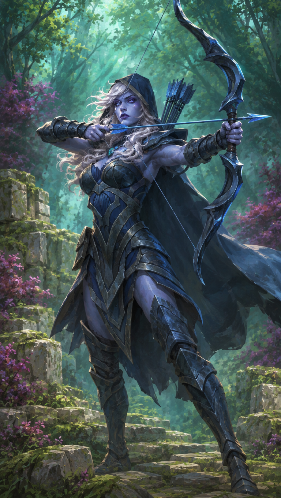
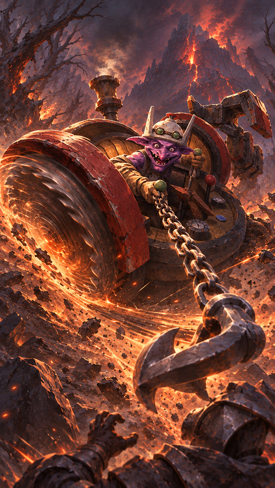
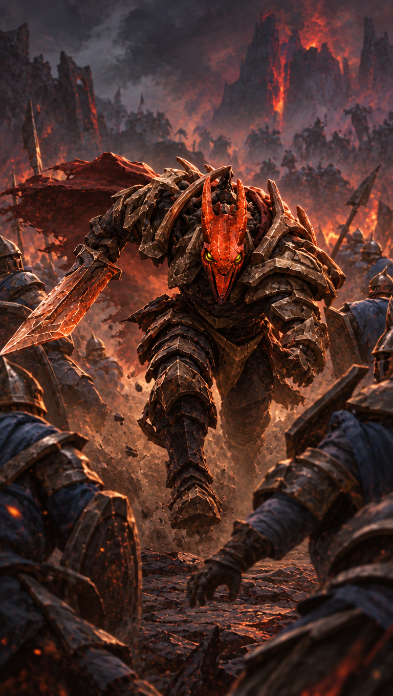
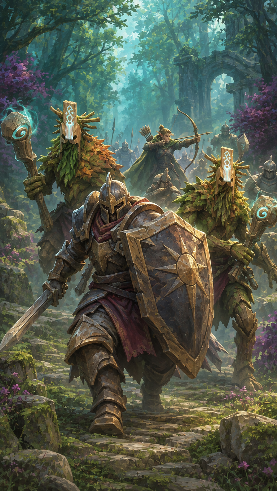
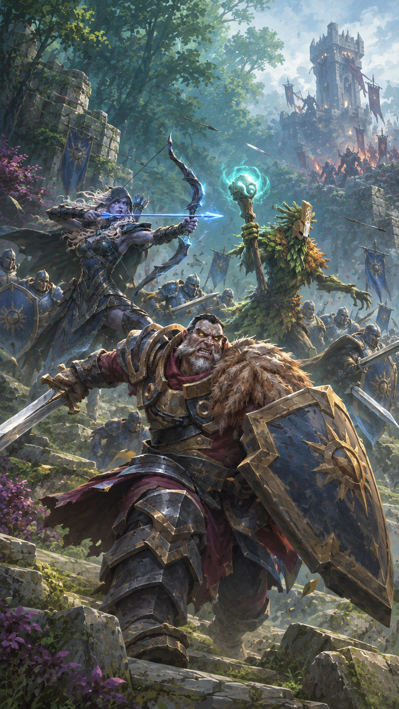

# Migoo 插画索引

按题材查询请先看[分类资源库](../art-library/README.md)，新会话生图先读[项目卡图 skill](../../.agents/skills/artifact-card-art/SKILL.md)。已用参考图和旧路径映射在[参考归档](../../references/card-art/README.md)。以下保留原批次说明、预览和历史记录；任务提交、成图下载、用户认可与游戏接入分别记录。

## 11 月 23 日终极技能追加

按剩余额度继续生成了斯温的神之力量、美杜莎的石化凝视、痛苦女王的超声冲击波和末日使者的末日，共 4 张。英雄与目标使用官方英雄渲染或已有单位图，每张另配两张 Classic 无框原画。实际返回模型均为 GPT Image 2.6 Flare，原图均为 768×1360。免费余额读到 0 后，下一单死神镰刀被入口拦截，流程按用户要求停止。 [英雄、目标与成图对照](hero-ultimates-01/review.html) · [四张总览](hero-ultimates-01/preview.jpg) · [提示词](hero-ultimates-01/briefs.json) · [素材清单](hero-ultimates-01/manifest.json) · [生成与停止记录](hero-ultimates-01/generation-status.json)

## 11 月 23 日第二批 20 个英雄技能场景

新增雷神之怒、极寒领域、死亡之指、群蛇守卫、死亡守卫、薄葬、幽灵船、毁灭、两极反转、黑洞、阳炎冲击、超新星、移形换位、动能力场、真空、连环霜冻、月神之箭、风暴之拳、海象神拳和梦境缠绕。按官方资料记录英雄、技能名与说明，使用对应英雄渲染、其他英雄或既有单位图作出场参考，每张另配两张 Classic 无框原画。召唤守卫的造型另参考对应官方技能图标。实际返回模型均为 GPT Image 2.6 Flare，原图均为 768×1360。 [英雄、目标与成图对照](hero-skill-scenes-02/review.html) · [前 10 张](hero-skill-scenes-02/preview-01.jpg) · [后 10 张](hero-skill-scenes-02/preview-02.jpg) · [总览](hero-skill-scenes-02/preview.jpg) · [提示词与官方来源](hero-skill-scenes-02/briefs.json) · [素材清单](hero-skill-scenes-02/manifest.json)

## 11 月 23 日首批 10 个英雄技能场景

按 Dota 官方英雄资料选择莉娜的龙破斩、撼地者的沟壑、帕吉的肉钩、主宰的剑刃风暴、拉比克的隔空取物、风行者的束缚击、全能骑士的守护天使、斧王的狂战士之吼、虚空假面的时间结界和沙王的掘地穿刺。英雄保留官方造型，目标使用其他英雄或此前生成的单位，每张另配两张 Classic 无框原画参考笔触与用光。实际返回模型均为 GPT Image 2.6 Flare，原图均为 768×1360。 [英雄、目标与成图对照](hero-skill-scenes-01/review.html) · [成图总览](hero-skill-scenes-01/preview.jpg) · [提示词与官方技能来源](hero-skill-scenes-01/briefs.json) · [素材清单](hero-skill-scenes-01/manifest.json)

## 11 月 23 日第二批 20 张法术

20 张法术概念图扩展火焰、孢雾、声波、砂壳、复苏、重量转嫁、缴械、缝影、沉默、加速、净化、恐惧、熔流、聚铁、日蚀、盐蚀、纸鸟引路与折光空间等题材。12 张使用既有单位作出场对象，8 张描绘环境与器物变化。逐张设置作用方式、主色、明暗与景别，每张另配两张 Classic 无框原画。实际返回模型均为 GPT Image 2.6 Flare，原图均为 768×1360。 [参考与成图](unit-cast-spells-02/review.html) · [前 10 张](unit-cast-spells-02/preview-01.jpg) · [后 10 张](unit-cast-spells-02/preview-02.jpg) · [全部总览](unit-cast-spells-02/preview.jpg) · [提示词与出场单位](unit-cast-spells-02/briefs.json) · [素材清单](unit-cast-spells-02/manifest.json)

## 11 月 23 日既有单位出场的法术插画

10 张法术概念图参考 Classic 无框原画的笔触、用光和空间组织。凝霜缚足、潮幕护持、引雷贯锁、藤攫拖拽、跃影换位、疾风推阵和蚀甲灼痕使用此前生成的单位图作角色参考。裂地涌泉、悬石封径和逆沙回时描绘环境与器物变化。每张使用两张 Classic 无框画作风格参考，出场对象及原始素材路径逐张记录。实际返回模型均为 GPT Image 2.6 Flare，原图均为 768×1360。 [单位与法术成图对照](unit-cast-spells-01/review.html) · [成图总览](unit-cast-spells-01/preview.jpg) · [小卡预览](unit-cast-spells-01/small-preview.png) · [提示词与出场单位](unit-cast-spells-01/briefs.json) · [素材清单](unit-cast-spells-01/manifest.json)

## 11 月 22–23 日原创小兵立绘

沿用户提供的天羽族、军团、虫族、蛙族与兽类参考，补出 46 张原创普通单位。首批 10 张已由用户确认通过，后续 36 张按批量探索保存。实际返回模型均为 GPT Image 2.6 Flare，原图均为 768×1360。暂停日期已由用户续至 2026-11-24。

[首批 10 张](skyfolk-unit-batch-01/index.html) · [第二批 16 张](skyfolk-unit-batch-02/index.html) · [第三批 20 张](skyfolk-unit-batch-03/index.html) · [累计清单与审核状态](skyfolk-units-manifest.json)

## 11 月 23 日非人普通单位续批

10 张新单位包括暮坡嗅迹兽、山口驮水兽、矮墙破障兽、石埠钉桩手、窄桥探哨、关口称货员、蒲湾抬篓工、潮沟灯侍、藤索编结工和仓场筛砂偶。前六张沿用《Are We Heroes Yet?》与《最后的城堡》的配角和生物参考，另加入此前已使用的蛙族、鱼形居民、树形工匠与机械体参考。每张各自设计动作、镜头、主色和光源。实际返回模型均为 GPT Image 2.6 Flare，原图均为 768×1360。 [参考与成图](comic-npc-batch-05/review.html) · [成图总览](comic-npc-batch-05/preview.jpg) · [小卡预览](comic-npc-batch-05/small-preview.png) · [提示词](comic-npc-batch-05/briefs.json) · [素材清单](comic-npc-batch-05/manifest.json)

## 11 月 23 日漫画普通单位扩展

10 张新单位沿用上一批六组漫画配角与生物参考，扩展为苇荡伏兽、峭石跃兽、渡口驮盐兽、陶罐驮兽、碎冰推舟兽、石场拖橇兽、营地炊事长、滩口拖缆手、树根采菌者和旧闸扳轮手。每张分别设置动作、镜头、主色和光源，使用两张 Classic 无框原画参考笔触与用光。实际返回模型均为 GPT Image 2.6 Flare，原图均为 768×1360。 [参考与成图](comic-npc-batch-04/review.html) · [成图总览](comic-npc-batch-04/preview.jpg) · [小卡预览](comic-npc-batch-04/small-preview.png) · [提示词](comic-npc-batch-04/briefs.json) · [素材清单](comic-npc-batch-04/manifest.json)

## 11 月 22 日其他漫画配角与生物

6 张单位参考来自《Are We Heroes Yet?》和《最后的城堡》的漫画局部，分别为鬃背巡兽、长角驮商兽、浅泥披甲兽、林营铜铃守卫、长肢拾荒者和獠牙门卫，名称用于本作设计工作。每张另配两张 Classic 无框原画。请求与实际返回模型均为 GPT Image 2.6 Flare，原图均为 768×1360。獠牙门卫首单因并发上限明确未启动，原提示词补交后完成。 [参考与成图](comic-npc-batch-03/review.html) · [总览](comic-npc-batch-03/preview.jpg) · [提示词](comic-npc-batch-03/briefs.json) · [素材清单](comic-npc-batch-03/manifest.json)

## 11 月 22 日世界观普通单位

10 张普通单位卡图，以用户选出的蛙族、古铜军团参考和《暗黑狂欢》客户端对话立绘提供角色线索，另配两张 Classic 无框原画参考笔触与用光。请求与实际返回模型均为 GPT Image 2.6 Flare，1K、9:16，原图均为 768×1360。用户已确认岗位提案并授权直接出图。

题材包括栈桥补网工、浅滩探路者、芦岸护篓兵、随军辎重手、队列传令兵、营地补甲匠、巡场检修偶、河沟采药人、棚外挂灯工和集市账房。镜头、动作、主色与光源逐张设置。采药人的宽帽遮住了大半张脸，小卡脸部辨识偏弱。 [参考与成图对照](lore-unit-batch-02/review.html) · [成图总览](lore-unit-batch-02/preview.jpg) · [48 像素小卡](lore-unit-batch-02/small-preview.png)

角色原始参考与实际上传的参考副本均保存在批次目录，后七张上传副本使用最长边 1024 像素的 JPEG。逐张描述、参考顺序和请求参数见提示词，实际模型、尺寸、任务 ID、媒体 ID 与原图 SHA-256 见素材清单。 [提示词](lore-unit-batch-02/briefs.json) · [素材清单](lore-unit-batch-02/manifest.json)

账户免费余额初查为 94，完成后为 83，付费余额为 0。同期另有会话生成图片，余额差保留为账户读数。

## 11 月 21 日候选插画

共 150 张，使用 GPT Image 2.6 Flare（1K、9:16），每张原图为 768×1360 PNG。候选图已下载并建立清单，等选图后再按卡牌或建筑 ID 接入。参考图来源、风格取舍、生成命令和验收要点见[卡牌插画工作流](../../docs/development/card-art-workflow.md)。

| 批次 | 张数 | 题材和预览 | 提示词与原图索引 |
| --- | ---: | --- | --- |
| 蓝色法术 | 7 | 五点落雷、贯巷冰潮、涡流牵阵、霜线封路、回响蓄能、镜门补位、塔芯共振。[预览](blue-spell-concepts/preview.jpg) · [小卡对照](blue-spell-concepts/small-preview.jpg) | [提示词](blue-spell-concepts/briefs.json) · [素材清单](blue-spell-concepts/manifest.json) |
| 黑色法术 | 7 | 破绽一击、踏隙追击、换影突入、断咒暗针、死印传递、悬赏结算、城脚暗雷。[预览](black-spell-concepts/preview.jpg) · [原版与成图对照](black-spell-concepts/style-comparison.jpg) | [提示词](black-spell-concepts/briefs.json) · [素材清单](black-spell-concepts/manifest.json) |
| 首批蓝黑单位 | 6 | 蓝色的潮闸守卫、蓄灯侍从、棱镜炮手。黑色的檐影斥候、赏金弩手、撬墙工兵。[预览](blue-black-unit-concepts/preview.jpg) · [小卡对照](blue-black-unit-concepts/small-preview.jpg) | [提示词](blue-black-unit-concepts/briefs.json) · [素材清单](blue-black-unit-concepts/manifest.json) |
| 四色单位 | 80 | 红、黑、蓝、绿各 20 张，包含士兵、后勤职业、野兽和机械。 [红](four-color-unit-concepts/red-preview.jpg) · [黑](four-color-unit-concepts/black-preview.jpg) · [蓝](four-color-unit-concepts/blue-preview.jpg) · [绿](four-color-unit-concepts/green-preview.jpg) · [小卡总览](four-color-unit-concepts/small-preview.jpg) | [提示词](four-color-unit-concepts/briefs.json) · [素材清单](four-color-unit-concepts/manifest.json) |
| 营地野怪 | 12 | 取材自《刀塔》的狗头人、萨特、半人马、鹰身女妖、泥土傀儡和远古龙蜥等营地。[预览](neutral-camp-concepts/preview.jpg) · [小卡对照](neutral-camp-concepts/small-preview.jpg) | [提示词](neutral-camp-concepts/briefs.json) · [素材清单](neutral-camp-concepts/manifest.json) |
| 共享装备 | 20 | 涵盖位移、保命、控场、破甲和法术应对。第一批选定原力法杖、风杖、幽魂权杖、微光披风、清莲宝珠、林肯法球、阿托斯之棍和黯灭，再补 12 件。[预览](dota-equipment-concepts/preview.jpg) · [官方图标与成图对照](dota-equipment-concepts/icon-comparison.jpg) | [提示词](dota-equipment-concepts/briefs.json) · [素材清单](dota-equipment-concepts/manifest.json) |
| 阵营建筑 | 6 | 天辉、夜魇各一座防御塔、一处基地核心和一座泉水。[预览](faction-building-concepts/preview.jpg) | [提示词](faction-building-concepts/briefs.json) · [素材清单](faction-building-concepts/manifest.json) |
| 原创英雄 | 12 | 从未进入 Classic 的《刀塔》英雄取职业、能力和战术主题，新设计角色和器物。复晓鹤、釉甲滚斗士、悬礁引石灵的小图轮廓最清楚。[英雄总览](hero-archetype-concepts/all-heroes-preview.jpg) · [小卡对照](hero-archetype-concepts/all-heroes-small-preview.jpg) | [前六张提示词](hero-archetype-concepts/briefs.json) · [前六张素材](hero-archetype-concepts/manifest.json) · [后六张提示词](hero-archetype-concepts-more/briefs.json) · [后六张素材](hero-archetype-concepts-more/manifest.json) |

每批的 `briefs.json` 保存逐张画面描述、共用风格要求、参数和实际参考图顺序。`manifest.json` 记录原图相对路径、尺寸、SHA-256、任务 ID、媒体 ID 和实际模型，媒体文件名统一为 `original.png`。

英雄题材保留《刀塔》英雄的玩法灵感。本作角色和器物采用独立设计，名称用于找图和推进后续卡牌设计。

| 原创英雄 | 题材灵感 | 原创英雄 | 题材灵感 |
| --- | --- | --- | --- |
| 潮标守望 | 昆卡的潮汐与海上救援 | 界铃引渡人 | 穆尔塔的亡魂与引渡 |
| 轮候星官 | 祈求者的多系法术 | 赤皮梢猎 | 森海飞霞的林间猎手 |
| 拓咒陶师 | 拉比克的法术复写 | 釉甲滚斗士 | 石鳞剑士的滚动战术 |
| 驼炉机匠 | 电炎绝手的骑乘与工程 | 影砖画匠 | 天涯墨客的影子与连结 |
| 复晓鹤 | 凤凰的光焰与复生 | 悬礁引石灵 | 艾欧的牵引与同行 |
| 门阵统领 | 玛尔斯的阵型与封锁 | 暮梦透翅蛾 | 帕克的梦境与位移 |

## 11 月 20 日扩充试玩插画

2026-11-20 使用 Migoo 生成 8 张纯插画 PNG，全部为 768×1360。请求与实际返回模型均为 GPT Image 2.6 Flare，1K、9:16。逐张检查未见卡框、文字、数值、UI 或水印。伐木机、卓尔、两张专属和两张推进法术已接入扩充试玩预设。巨力挥舞与绿色选行攻击法术的原图已保存。

参考 Artifact 原版卡画与现有天辉／夜魇素材；伐木机、卓尔的专属另参考本批对应英雄图。

| 图片 | 名称与原图 |
| --- | --- |
|  | [伐木机](hero-timbersaw/original.png) |
|  | [卓尔游侠](hero-drow-ranger/original.png) |
|  | [伐木锯链](signature-timber-chain/original.png) |
|  | [狂风](signature-gust/original.png) |
|  | [破阵冲锋](spell-breakthrough-charge/original.png) |
|  | [协同行军](spell-coordinated-march/original.png) |
|  | [巨力挥舞](spell-mighty-swing/original.png) |
|  | [绿色选行攻击法术（未命名）](spell-green-row-assault/original.png) |

完整提示词与参考：[生成清单](card-art-queue-2026-11-20.json)。实际模型、尺寸、来源及 SHA-256：[素材记录](manifest.json)。

账户读取的免费余额为 95 → 92，付费余额仍为 0；近期交易列出本批八笔各 -1，尚未与余额差一致，不将差额认定为精确批次成本。
