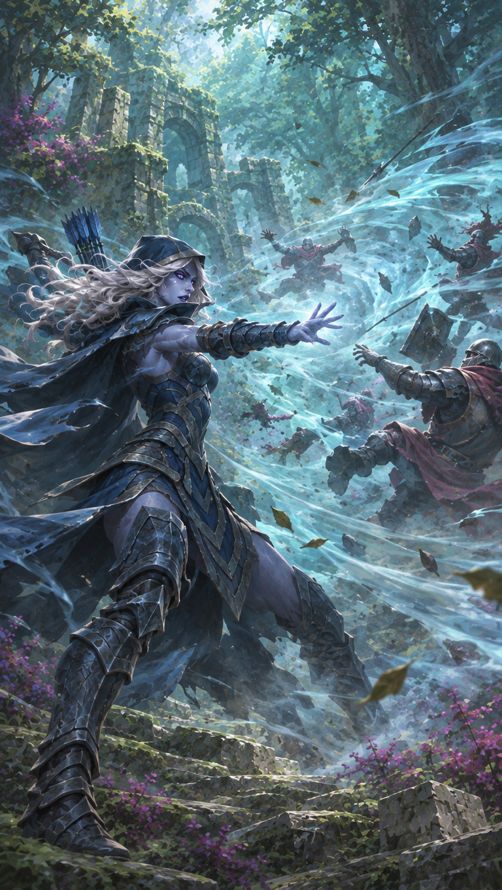
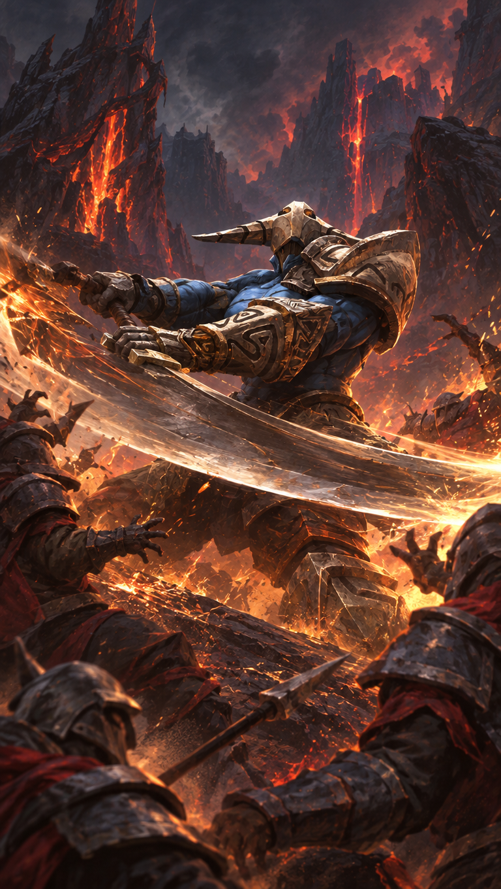

# Migoo 插画索引

## 11 月 21 日候选插画

共 150 张，使用 GPT Image 2.6 Flare（1K、9:16），每张原图为 768×1360 PNG。候选图已下载并建立清单，等选图后再按卡牌或建筑 ID 接入。参考图来源、风格取舍、生成命令和验收要点见[卡牌插画工作流](../../docs/development/card-art-workflow.md)。

| 批次 | 张数 | 题材和预览 | 提示词与原图索引 |
| --- | ---: | --- | --- |
| 蓝色法术 | 7 | 五点落雷、贯巷冰潮、涡流牵阵、霜线封路、回响蓄能、镜门补位、塔芯共振。[预览](blue-spell-concepts/preview.jpg) · [小卡对照](blue-spell-concepts/small-preview.jpg) | [提示词](blue-spell-concepts/briefs.json) · [素材清单](blue-spell-concepts/manifest.json) |
| 黑色法术 | 7 | 破绽一击、踏隙追击、换影突入、断咒暗针、死印传递、悬赏结算、城脚暗雷。[预览](black-spell-concepts/preview.jpg) · [原版与成图对照](black-spell-concepts/style-comparison.jpg) | [提示词](black-spell-concepts/briefs.json) · [素材清单](black-spell-concepts/manifest.json) |
| 首批蓝黑单位 | 6 | 蓝色的潮闸守卫、蓄灯侍从、棱镜炮手。黑色的檐影斥候、赏金弩手、撬墙工兵。[预览](blue-black-unit-concepts/preview.jpg) · [小卡对照](blue-black-unit-concepts/small-preview.jpg) | [提示词](blue-black-unit-concepts/briefs.json) · [素材清单](blue-black-unit-concepts/manifest.json) |
| 四色单位 | 80 | 红、黑、蓝、绿各 20 张，包含士兵、后勤职业、野兽和机械。 [红](four-color-unit-concepts/red-preview.jpg) · [黑](four-color-unit-concepts/black-preview.jpg) · [蓝](four-color-unit-concepts/blue-preview.jpg) · [绿](four-color-unit-concepts/green-preview.jpg) · [小卡总览](four-color-unit-concepts/small-preview.jpg) | [提示词](four-color-unit-concepts/briefs.json) · [素材清单](four-color-unit-concepts/manifest.json) |
| 营地野怪 | 12 | 取材自《刀塔》的狗头人、萨特、半人马、鹰身女妖、泥土傀儡和远古龙蜥等营地。[预览](neutral-camp-concepts/preview.jpg) · [小卡对照](neutral-camp-concepts/small-preview.jpg) | [提示词](neutral-camp-concepts/briefs.json) · [素材清单](neutral-camp-concepts/manifest.json) |
| 共享装备 | 20 | 涵盖位移、保命、控场、破甲和法术应对。第一批选定原力法杖、风杖、幽魂权杖、微光披风、清莲宝珠、林肯法球、阿托斯之棍和黯灭，再补 12 件。[预览](dota-equipment-concepts/preview.jpg) · [官方图标与成图对照](dota-equipment-concepts/icon-comparison.jpg) | [提示词](dota-equipment-concepts/briefs.json) · [素材清单](dota-equipment-concepts/manifest.json) |
| 阵营建筑 | 6 | 天辉、夜魇各一座防御塔、一处基地核心和一座泉水。[预览](faction-building-concepts/preview.jpg) | [提示词](faction-building-concepts/briefs.json) · [素材清单](faction-building-concepts/manifest.json) |
| 原创英雄 | 12 | 从未进入 Classic 的《刀塔》英雄取职业、能力和战术主题，新设计角色和器物。复晓鹤、釉甲滚斗士、悬礁引石灵的小图轮廓最清楚。[英雄总览](hero-archetype-concepts/all-heroes-preview.jpg) · [小卡对照](hero-archetype-concepts/all-heroes-small-preview.jpg) | [前六张提示词](hero-archetype-concepts/briefs.json) · [前六张素材](hero-archetype-concepts/manifest.json) · [后六张提示词](hero-archetype-concepts-more/briefs.json) · [后六张素材](hero-archetype-concepts-more/manifest.json) |

每批的 `briefs.json` 保存逐张画面描述、共用风格要求、参数和实际参考图顺序。`manifest.json` 记录原图相对路径、尺寸、SHA-256、任务 ID、媒体 ID 和实际模型，媒体文件名统一为 `original.png`。

英雄题材保留《刀塔》英雄的玩法灵感。本作角色和器物采用独立设计，名称用于找图和推进后续卡牌设计。

| 原创英雄 | 题材灵感 | 原创英雄 | 题材灵感 |
| --- | --- | --- | --- |
| 潮标守望 | 昆卡的潮汐与海上救援 | 界铃引渡人 | 穆尔塔的亡魂与引渡 |
| 轮候星官 | 祈求者的多系法术 | 赤皮梢猎 | 森海飞霞的林间猎手 |
| 拓咒陶师 | 拉比克的法术复写 | 釉甲滚斗士 | 石鳞剑士的滚动战术 |
| 驼炉机匠 | 电炎绝手的骑乘与工程 | 影砖画匠 | 天涯墨客的影子与连结 |
| 复晓鹤 | 凤凰的光焰与复生 | 悬礁引石灵 | 艾欧的牵引与同行 |
| 门阵统领 | 玛尔斯的阵型与封锁 | 暮梦透翅蛾 | 帕克的梦境与位移 |

## 11 月 20 日扩充试玩插画

2026-11-20 使用 Migoo 生成 8 张纯插画 PNG，全部为 768×1360。请求与实际返回模型均为 GPT Image 2.6 Flare，1K、9:16。逐张检查未见卡框、文字、数值、UI 或水印。伐木机、卓尔、两张专属和两张推进法术已接入扩充试玩预设。巨力挥舞与绿色选行攻击法术的原图已保存。

参考 Artifact 原版卡画与现有天辉／夜魇素材；伐木机、卓尔的专属另参考本批对应英雄图。

| 图片 | 名称与原图 |
| --- | --- |
|  | [伐木机](hero-timbersaw/original.png) |
|  | [卓尔游侠](hero-drow-ranger/original.png) |
|  | [伐木锯链](signature-timber-chain/original.png) |
|  | [狂风](signature-gust/original.png) |
|  | [破阵冲锋](spell-breakthrough-charge/original.png) |
|  | [协同行军](spell-coordinated-march/original.png) |
|  | [巨力挥舞](spell-mighty-swing/original.png) |
|  | [绿色选行攻击法术（未命名）](spell-green-row-assault/original.png) |

完整提示词与参考：[生成清单](card-art-queue-2026-11-20.json)。实际模型、尺寸、来源及 SHA-256：[素材记录](manifest.json)。

账户读取的免费余额为 95 → 92，付费余额仍为 0；近期交易列出本批八笔各 -1，尚未与余额差一致，不将差额认定为精确批次成本。
